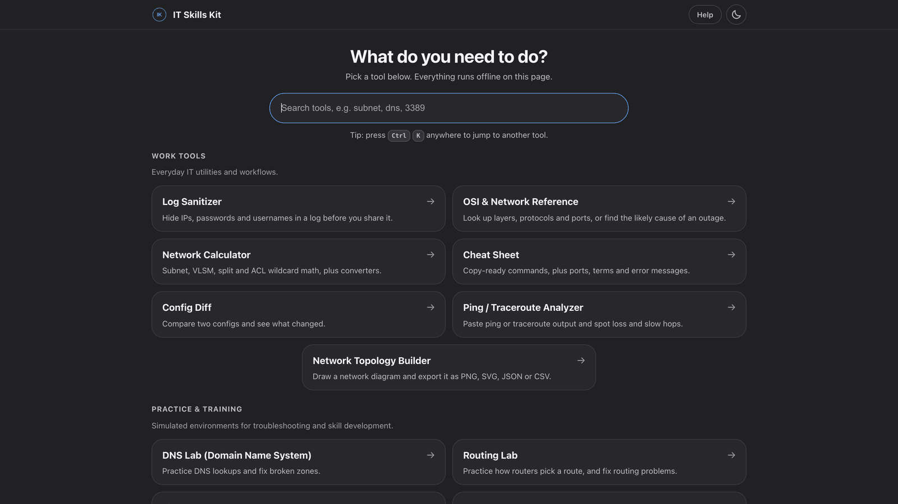
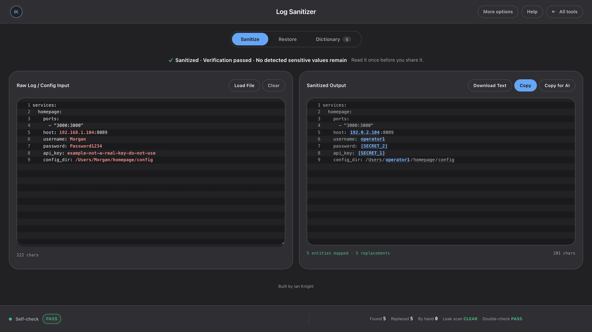
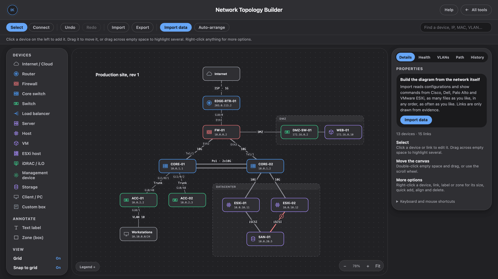

# IT Skills Kit

[](https://github.com/the-best-Knight/network-skills-kit/actions/workflows/check.yml)

Offline networking and IT tools in a single HTML file. Twelve tools: seven for everyday work and five for practice. No server, no install, and no external requests. Everything runs in your browser.

**[Open it live](https://ianknight.org/tools/network-skills-kit.html)** · **[Download `index.html`](https://raw.githubusercontent.com/the-best-Knight/network-skills-kit/main/index.html)** · [How it was built](https://ianknight.org/projects/it-skills-kit/)



## What's inside

**Work tools**

| Tool | What it does |
| --- | --- |
| Log Sanitizer | Hides IPs, passwords, usernames and other secrets in a log before you share it |
| OSI & Network Reference | Layers, protocols and ports, plus a symptom-based guide to the likely cause of an outage |
| Network Calculator | Subnet, VLSM, supernet, split and ACL wildcard math, bandwidth and hash calculators, converters |
| Cheat Sheet | Copy-ready switch and router commands (Cisco, Dell, Junos), ports, terms and error messages |
| Config Diff | Compare two configs and see exactly what changed |
| Ping / Traceroute Analyzer | Paste ping or traceroute output and spot loss and slow hops |
| Network Topology Builder | Draw a network diagram, or build one from device configs, and export it as PNG, SVG, JSON or CSV |

**Practice labs**

| Lab | What it does |
| --- | --- |
| DNS Lab | Offline DNS simulator: dig-style queries, a zone database, broken-record scenarios |
| Routing Lab | Longest-prefix match, live routing tables, packet path visualization |
| Firewall Rules Lab | ACL simulator: ordered rules, a packet tester, implicit deny, policy scenarios |
| Network Fault Lab | Diagnose-and-fix scenarios with a live topology and a practice switch or router console |
| vSphere Sandbox | Practice common vSphere tasks in a safe offline copy |

## Private by design

- **No network requests.** Each tool carries a strict Content Security Policy that blocks outbound connections, so what you paste has nowhere to go.
- **Nothing uploads.** Settings are kept in your browser's local storage and nowhere else.
- **Encrypted export.** Anything the Log Sanitizer saves is encrypted with AES-GCM or OpenSSL-compatible encryption.

## Log Sanitizer

Paste a log, config dump, or command output and it redacts sensitive values as you type: internal IPs, hostnames, usernames, API keys, tokens, passwords, and anything matching a pattern you add. Use it before a log goes into a support ticket, a vendor case, a chat, or an AI tool.



- **Checks its own work.** A leak scan and an independent double-check run after every redaction, and a self-test runs when the page loads.
- **Reversible.** A dictionary keeps what each placeholder replaced, so a reply that still has the placeholders can be restored in the same session.
- **Configurable.** Sensitivity presets (Strict, Standard, Technical, Audit-only), detection profiles for Cisco, Dell OS10, VMware/ESXi, Windows/AD and Kubernetes, and your own rules.

## Network Topology Builder

Draw a diagram by hand, or import configs and show output from Cisco, Dell, Palo Alto and VMware ESXi and let it build the diagram. Links are only drawn when the data supports them.



## Using it

Open `index.html` in a current desktop browser (Chrome, Edge, Firefox or Safari). It is built for a mouse and keyboard. Each tool is embedded in the file and loads on demand, so there is nothing to install or configure.

## Checking the file

`index.html` is one large file, and a single syntax error in a script stops that whole script from running. Before pushing a change, run:

```bash
node scripts/check-scripts.mjs
```

It syntax-checks every script in the page and in each embedded tool, and exits with an error naming the tool if anything fails to parse. It needs Node 18 or newer, and the same check runs on every push.

## Changelog

See [CHANGELOG.md](CHANGELOG.md).

## License

[MIT](LICENSE). Use it, change it, and share it, and keep the copyright notice.

---

Built by [Ian Knight](https://ianknight.org).
